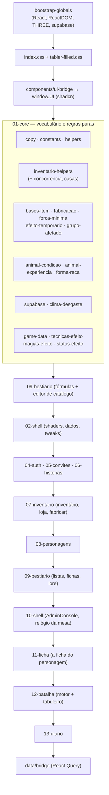
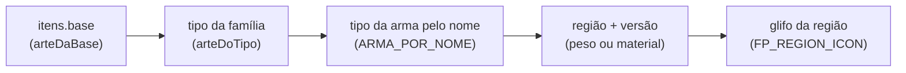
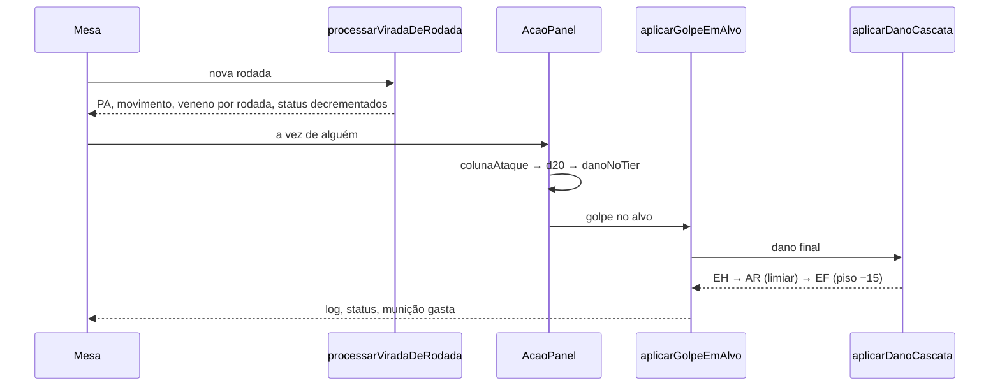
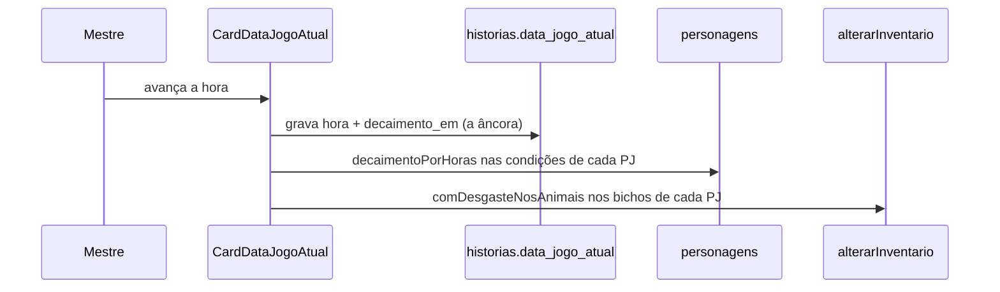
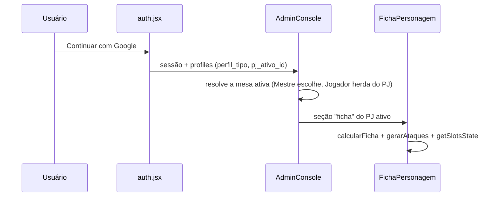

# Mapa da base de código — Menestrel

> Gerado pelo Cartographer em 27/10/2026, a partir da leitura de `src/` inteiro
> (sem os `*.test.*`, que são 1,1 M dos 1,66 M de tokens do repositório).

O Menestrel é um SaaS para mesas de RPG do sistema **Tagmar**: o Mestre conduz
uma história com relógio, clima, loja e batalha; o Jogador tem uma ficha viva,
inventário, diário e companheiros. Vite + React 19 + Tailwind v4 + Supabase.

---

## 1. A regra que explica o resto: fases no `window`

**Não há `import`/`export` entre as fases.** Cada arquivo `src/NN-*/…jsx`
declara funções no escopo do módulo e as publica em `window` com um
`Object.assign(window, { … })` no fim. Quem consome lê do `window`, quase
sempre no padrão defensivo:

```js
const f = (typeof decaimentoPorHoras === 'function' ? decaimentoPorHoras : null)
  || window.decaimentoPorHoras;
```

Esse padrão existe por duas razões: o módulo continua testável sozinho, e a
ordem de carga deixa de ser uma amarra rígida para virar uma preferência.

**A ordem de carga é regra de negócio, não acidente.** Ela está em
`src/main.tsx` e é a espinha dorsal da arquitetura — mover uma linha ali pode
deixar uma função `undefined` no `window` e o erro só aparece em runtime,
dentro de um `onClick`, em silêncio.



**A ordem exata** (`src/main.tsx`), que vale como índice do projeto:

```
01-core/copy · constants · helpers · inventario-helpers
01-core/bases-item · fabricacao · forca-minima · efeito-temporario · grupo-afetado
01-core/animal-condicao · animal-experiencia · forma-raca   ← registra Vampiro/Lobisomem
01-core/select-pill · supabase · clima-desgaste · game-data
01-core/tecnicas-efeito · magias-efeito · status-efeito
09-bestiario/ataques-criatura · criatura-formulas · catalogo-descritores · catalogo-editor
02-shell/shaders · dado-d20 · dado-d10 · tweaks-panel
04-auth/auth · 05-convites/convites · 06-historias/historias
07-inventario/inventario · loja · fabricar · 06-historias/estoque-mestre
08-personagens/personagens · guia_personagem
09-bestiario/conhecido-jogador · painel-modal · bestiario · sugestoes-magias · itens-campanha
10-shell/shell · galeria-imagens
11-ficha/atalhos-ficha · amigos-fab · ficha   →   ../app.jsx (raiz do repo)
12-batalha/batalha · tabuleiro               →   13-diario/diario
data/bridge   →   mount com <QueryClientProvider><App/></QueryClientProvider>
```

Dois arquivos de 01-core **não** aparecem nessa lista: `inventario-concorrencia`
e `inventario-casas` entram por `import` ES de dentro de `inventario-helpers`, e
`sessao-retry` de dentro de `supabase`. Não existe fase `03-*`.

---

## 2. Estrutura de diretórios

| Caminho | O que é |
|---|---|
| `src/01-core/` | Dados de Tagmar e **todas** as regras puras. Sem React, sem telas. |
| `src/02-shell/` | Shaders de fundo, dados d20/d10, painel de tweaks. |
| `src/04-auth/` | Login por Google e a primeira entrada ("vou mestrar"/"vou jogar"). |
| `src/05-convites/` | Convite de mesa (códigos, aceite, aventuras do jogador). |
| `src/06-historias/` | Histórias/mesas do Mestre, loja por cidade, estoque. |
| `src/07-inventario/` | Inventário, loja do jogador, bancada de fabricação. |
| `src/08-personagens/` | Lista de PJs, wizard de criação/evolução, guia das regras. |
| `src/09-bestiario/` | Catálogo (criaturas, itens, magias, técnicas, habilidades) e seu editor genérico. |
| `src/10-shell/` | O console: barra lateral, navegação, trilho do topo, relógio da mesa. |
| `src/11-ficha/` | A ficha do personagem e a do companheiro. |
| `src/12-batalha/` | O motor de combate e o tabuleiro. |
| `src/13-diario/` | Diário do jogador, lore da mesa, Jornal de Aventuras. |
| `src/data/` | React Query: `queryClient`, schemas Zod, hooks-ponte. |
| `src/components/` | Kit shadcn + a ponte `window.UI`. |
| `src/index.css` | 15 000 linhas, 1 MB: tokens, design system e o diário datado da UI. |
| `scripts/sql/` | As migrações, uma por pedido, com conferência no rodapé. |
| `docs/superpowers/` | Specs e planos das features grandes. |

---

## 3. Guia por módulo

### 01-core — o vocabulário

**Propósito.** Dados estáticos de Tagmar e as fórmulas que os leem. Nenhum
arquivo daqui conhece tela.

| Arquivo | Papel |
|---|---|
| `copy.jsx` | i18n PT/EN (`COPY`) de seis domínios de tela. |
| `constants.jsx` | Calendário fantasy (361 dias), copy do admin e as **árvores de navegação** (`ADMIN_MENU`, `NAV_MESA`, `ADMIN_SECTIONS`, `PARTES_DA_FICHA`). |
| `helpers.jsx` | Hooks React globais, conversão de data fantasy ↔ dia absoluto, tooltip, pilha de modais, `QuantidadeStepper`. |
| `inventario-helpers.jsx` | O hub de domínio (~1 430 linhas): moedas, slots, containers, armadura, `gerarAtaques`, o parser de efeitos de item, munição/veneno, ritual. |
| `inventario-concorrencia.jsx` | Compare-and-swap de `personagens.inventario` (ver §6). |
| `inventario-casas.jsx` | Posição dos itens na grade do baú. |
| `bases-item.jsx` | A **base** do item (o que ele é) separada do **exemplar** (como se chama). |
| `game-data.jsx` | `GAME_DATA` + `calcularFicha` — a função central do sistema. |
| `magias-efeito.jsx` | O parser de prosa das magias (~2 180 linhas) e o registro de semântica. |
| `tecnicas-efeito.jsx` | O registro das técnicas e a auditoria texto-do-banco × número-do-código. |
| `status-efeito.jsx` | Status que sobrevive à batalha, com vencimento no calendário. |
| `clima-desgaste.jsx` | Fome, sede, sono e temperatura por hora de relógio; atividades e treino. |
| `efeito-temporario.jsx` | Bônus de item com prazo, que pode passar do teto e vence sozinho. |
| `fabricacao.jsx` | A bancada: receita, teste, consumo de material, dias de construção. |
| `forma-raca.jsx` | Vampiro e Lobisomem como **camada de leitura** sobre a raça. |
| `animal-experiencia.jsx` | O quinto de XP do dono e a evolução do bicho. |
| `animal-condicao.jsx` | O clima desgasta o animal; as barras dele abatem **atributo**. |
| `forca-minima.jsx` | Quem limita a arma é a Força, não a linhagem. |
| `grupo-afetado.jsx` | Qual recorte de PJs o relógio e o seletor de local alcançam. |
| `select-pill.jsx` | O dropdown único do sistema (lista por portal). |
| `supabase.jsx` + `sessao-retry.js` | O cliente, com renovação de JWT e um retry. |

**`calcularFicha(p, catalogoBySlug, condicoes, ventoDegrau, subraca, dataJogo)`**
é o centro: deriva atributos, EF/EH/RF/RM/Karma/Velocidade/Defesa/Absorção a
partir de atributos, raça, profissão, gênero, equipamento, condições, clima e
bônus temporário. Quase toda tela a chama.

### 09-bestiario — o catálogo e o editor que se descreve

**O padrão mais reutilizável do projeto** mora aqui, num par:

- `catalogo-descritores.jsx` é **dado**: para cada tabela editável declara
  `campos: [{ col, tipo, rotuloKey, opcoes?, derivado?, … }]`.
- `catalogo-editor.jsx` é **um formulário só**, que desenha qualquer uma das
  cinco tabelas a partir dessa descrição.

Quem quiser um sexto editor declara um descritor; não escreve JSX novo.

`criatura-formulas.jsx` guarda as fórmulas puras da criatura — EF = `⌈2√Peso +
Físico⌉`, EH = `(12+Aura)×Estágio`, VB = `(Físico+Agilidade)×Estágio`, RF/RM =
`Estágio + Físico/Aura` — e o editor as recalcula a cada tecla: o Mestre nunca
escreve um derivado à mão.

`bestiario.jsx` (~55 k tokens) tem as cinco listas paginadas, a busca global do
Livro de Regras e a **ficha de item** (`BestDetalheModal` + `BestItemFicha`) que
o inventário e a loja reaproveitam — mudar o desenho dela aqui muda nas três.

### 07-inventario — instância × catálogo

`public.itens` é **global**: a linha "Casa" é a mesma para todas as mesas.
`personagens.inventario.itens[]` é a **instância**, e é nela que mora tudo que é
de uma unidade possuída:

| Campo | Por que não é do catálogo |
|---|---|
| `equipado` / `slot` | Peça em uso, por personagem. |
| `vestido` / `vesteSlot` | Sistema **paralelo** ao de equipamento, para não colidir no `slot`. |
| `containerId` / `casa` | Dentro de qual recipiente, e em que casa da grade. |
| `quantidade` | Pilha — a política de empilhar depende do grupo e do lugar. |
| `anuncio_id` | Travado por estar à venda. |
| `montado` | Qual montaria está em uso — uma por vez. |
| `animal_id` / `slot_animal` | Peça posta **no bicho**: não pesa nas costas do dono. |
| `nome` | O dono batiza o companheiro; a raça é do catálogo. |
| `vitalidade` / `condicoes` / `xp` / `elo` | A ficha de vida daquele bicho. |
| `cidade` | O endereço de uma propriedade comprada. |
| `bonus` | Sagração daquela peça. |

Funções que valem conhecer: `normalizarPilhas` (devolve **o mesmo array** quando
nada muda — é o que impede o autosave de entrar em laço), `calcCarga`,
`guardarNoRecipiente`, `equiparNoAnimal`, `vitalidadeDoAnimal`,
`alimentarAnimal`, `acessoAPropriedade`.

### 11-ficha — a ficha, e a cadeia da pintura

`FichaPersonagem` é o maior componente do projeto (~6 200 linhas). Desenha o
**boneco de armar** (`fp3-*`): dois trilhos de 8 regiões ao redor do retrato e,
na base, o par Mão ⇄ Saque rápido de cada lado.

A **pintura de uma peça** é resolvida numa escada, do específico ao genérico:



`ARTE_PINTADA` é a fonte de verdade do que já foi pintado: mesmo que a escada
calcule um nome de arquivo válido, sem entrada no Set a função devolve `null` e
cai no degrau seguinte. A arma é a exceção da base — a base dela é só a classe
de peso, e a mão desenha o tipo, que sabe mais.

`FichaAnimaisView` é a ficha de **um** companheiro, no mesmo andaime da ficha do
personagem (`fp2-sheet > fp2-frame > fp2-columns--duas`), com as 12 casas do
arreamento no lugar das 16 regiões de gente.

### 12-batalha — o motor

`window.MotorBatalha` reúne ~150 funções **puras** do combate. A ficha e o
bestiário chamam as mesmas (`habilidadesDeCriatura`, `tecnicasDoAtor`,
`magiasConhecidasDoAtor`) — é o que impede a mesa de dizer um número e a ficha
outro.

O turno, em funções:



A **cascata de dano** é a área com mais correções do projeto: a armadura é um
**limiar**, não um poço (golpe até `ar` é bloqueado inteiro e gasta 1 de
resistência; não vaza o excedente), e a ordem das operações em `danoFinal` muda
o número.

`tabuleiro.jsx` é um caso à parte: foi **reconstruído a partir do bundle de
produção** porque o fonte original nunca foi commitado. A geometria e o CSS são
fiéis valor por valor; os nomes internos de função são invenção do reconstrutor.

### 10-shell — o console e o relógio

`AdminConsole` monta a barra lateral a partir de `NAV_MESA` (mesa ativa em cima,
Livro de Regras abaixo da régua) e escolhe a página num `if/else` longo por
seção. O Mestre navega pela **mesa ativa**; o Jogador, pelo **personagem ativo**.

`CardDataJogoAtual` é o trilho do topo: data, local, clima, sino. Mexer nele
cobra horas:



A **âncora** (`decaimento_em`) é até onde o desgaste já foi cobrado — não o
relógio anterior. Se uma escrita falhar, as horas ficam devendo em vez de sumir.

### 13-diario — o caderno de descobertas

O Mestre disponibiliza criaturas e lore (Reinos, Cidades, Locais, Pessoas) para
a história; o Jogador importa para o diário do PJ e comenta. Memórias são texto
livre. Reinos/cidades/pessoas são catálogo **global** com cópia por história —
editar um global dispara fork automático. A visibilidade por PJ mora em
`historias.lore_acesso_pj`: chave ausente ou lista vazia = todos veem.

`jornal-aventuras.jsx` é o mural da cidade; o campo `fim` (a solução da
aventura) é `soMestre`.

---

## 4. Convenções

- **Comentário é documentação de produto.** Quase todo bloco não óbvio começa
  com a frase do usuário que o pediu, com data. É a melhor fonte de "por que
  isto é assim" — e, quando for mudar, o lugar de registrar a nova decisão.
- **Vencimento preguiçoso.** Nada no projeto avança a data do jogo sozinho, e
  nenhuma rotina de fundo expira nada: `statusVigentes`, `magiasAtivasVigentes`,
  `formaVigente`, `efeitosTemporariosVigentes` e `itensComConstrucaoPronta`
  filtram contra a data **na leitura**.
- **A mesma lista devolvida quando nada muda.** Funções puras de inventário
  devolvem a referência original para não disparar gravação à toa.
- **Nome do arquivo = fase + assunto.** `src/NN-area/assunto.jsx`.
- **SQL por pedido.** Cada `scripts/sql/*-AAAA-MM-DD.sql` é idempotente e traz
  no rodapé as consultas de conferência.
- **Prefixos de CSS por geração**: `fp-` (213 classes) → `fp2-` (71) → `fp3-`
  (34) na ficha; `mn-` (56) é o design system atual, o Quadro de Iniciativa.
  Também `mc-` (console), `inv-` (inventário), `best-` (bestiário), `diario-`,
  `wiz-` (criação), `cdj-` (trilho da cena), `ms-` (ModalShell), `bau-`.
- **Tokens** em `.menestrel-ui`: `--fs-*` (13→32px), `--tinta`/`--tinta-2`/
  `--tinta-3`, `--vivo` (ouro: só o que está vivo), `--alerta` (brasa: só o que
  mudou ou bloqueia), `--regua`, `--inv-casa`, `--fp2-col-inset`.

### Testes que leem a fonte

Mais de 60 arquivos de teste fazem `readFileSync` no `.jsx`/`.css` e casam
regex contra o texto. O motivo está escrito neles: o bug que eles pegam **não
quebra nada em runtime** — ler um campo inexistente não lança erro em JS, só
produz um resultado silenciosamente errado.

Consequência para quem edita: reformatar uma linha pode quebrar um teste sem
mudar comportamento nenhum. Rode a suíte antes de mover código.

---

## 5. Fluxos principais

**Entrar e jogar**



**Usar um item** — `efeitosDoItem` (o parser de prosa) → `aplicarEfeitosItem`
→ `gravarEstadoAtual`. Dentro de combate o caminho é
`aplicarEfeitoItemSnapshot`, e as duas precisam dar o mesmo número: partilham o
parser de propósito.

**Fabricar** — a aba Fabricar só devolve a intenção; quem rola o d20, paga o
material e grava é a Ficha. Um escritor só do inventário.

---

## 6. Armadilhas

1. **`personagens.inventario` nunca por `update` direto.** É um jsonb gravado
   inteiro por três telas. Toda escrita passa por `window.alterarInventario`
   (compare-and-swap em `inventario_versao`) ou pelo gravador de três vias
   `gravarInventario`/`criarGravadorInventario`. Um update direto apaga em
   silêncio o que outra tela gravou entre a leitura e a escrita.
2. **`core.autocrlf=true`.** Regex multilinha sobre a fonte precisa de `\r?\n`.
   Um `\n` literal nunca casa, e o teste acusa zero com o código certo na frente.
3. **O `zoom` do `.fp-card`** cria contexto de empilhamento. Qualquer modal ou
   tooltip que precise ficar por cima da ficha vai por
   `ReactDOM.createPortal` para `document.querySelector('#root .menestrel-ui')`
   — nunca para `document.body` puro, porque todo o CSS é escopado em `#root` e
   o portal sairia sem pele.
4. **Hooks antes dos returns de carregamento.** `FichaPersonagem` tem returns de
   loading no meio do corpo; um hook declarado depois deles muda a contagem
   entre renders e a ficha inteira morre com "Rendered more hooks than during
   the previous render". Travado por `ficha-hooks-antes-dos-returns.test.js`.
5. **`function` de topo não vaza entre fases.** São módulos ES. Todo nome que
   outra fase chama precisa estar explicitamente no `Object.assign(window, …)`.
   O erro acontece dentro de um `onClick` e morre calado no console.
6. **`null` ≠ `undefined` em `proximaMesaAtiva`.** `undefined` é "não mexa"
   (lista carregando); `null` é "a mesa salva sumiu". Confundir os dois faz o
   console reentrar na mesa depois de sair.
7. **Nunca gravar `perfil_tipo` antes de saber o do servidor.** O palpite de
   montagem (`player`) vazava para o banco e rebaixava o Mestre em dispositivo
   novo, de forma persistente.
8. **`PJ_COLS` é uma lista única.** Um `select` que esqueça uma coluna e faça
   `setPjs(resultado)` apaga essa coluna do cache local de todos os PJs.
9. **Pilha que se parte.** `equiparNoAnimal` e `comEloNoAnimal` sempre tiram
   **uma unidade** e criam instância nova: código que assuma que mover um item
   de quantidade > 1 afeta a pilha inteira está errado.
10. **A ficha de item é compartilhada.** Mexer em `BestItemFicha` no bestiário
    muda o inventário e a loja junto. É intencional, mas surpreende.
11. **Escala do animal é outra.** O PJ perde até 6 pontos de um poço de dezenas;
    o atributo da criatura vive entre −2 e +6. `floor`, não `round`.
12. **`ehVestimenta` recusa quem tem `slot_arreio`.** É a porta que impede o
    inventário de oferecer "vestir uma sela" no personagem.
13. **O `supabaseClient` dos testes é um Proxy que lança em qualquer acesso.**
    Quem precisa de dados troca pelo `fake-supabase.js`.
14. **`estoque_loja` não é `inventario`.** Tem padrão de concorrência próprio
    (reler, aplicar, gravar), sem coluna de versão.

---

## 7. Guia de navegação

| Para… | Mexa em |
|---|---|
| mudar uma regra de ficha (EF, Karma, Velocidade) | `01-core/game-data.jsx` → `calcularFicha` |
| mudar uma regra de combate | `12-batalha/batalha.jsx` (`MotorBatalha`) + os testes da pasta |
| adicionar um campo editável no catálogo | `09-bestiario/catalogo-descritores.jsx` (só o descritor) |
| adicionar uma pintura | gerar no Figma pelo molde de `.impeccable/rotina-figma.md`, salvar em `public/equip` ou `public/itens`, registrar em `ARTE_PINTADA` (`11-ficha/ficha.jsx`) e, se for um tipo novo, em `01-core/bases-item.jsx` |
| adicionar um destino no menu | `01-core/constants.jsx` (`NAV_MESA` + `ADMIN_SECTIONS`) e o switch de `10-shell/shell.jsx` |
| mexer no que o relógio cobra | `01-core/clima-desgaste.jsx` (as regras) e `10-shell/shell.jsx` (a ida ao banco) |
| mexer no inventário | `01-core/inventario-helpers.jsx` (regras) e `07-inventario/inventario.jsx` (tela) |
| adicionar uma coluna no banco | um `scripts/sql/<assunto>-<data>.sql` idempotente, com conferência no rodapé |
| mudar a identidade visual | `src/index.css` (tokens em `.menestrel-ui`) e a skill `impeccable` |
